

  
  

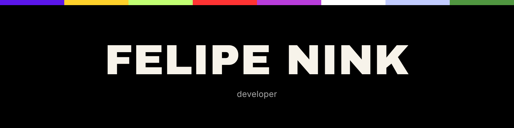
 

  Developer · building systems that solve real business problems

  &nbsp;&nbsp;
  &nbsp;&nbsp;
  

<h3>Projects</h3>

  <a href="https://coopfoods.com.br">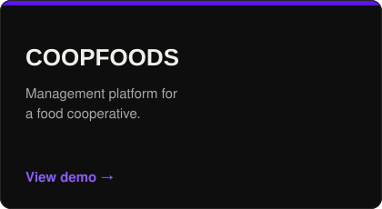</a>
  <a href="#">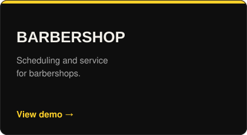</a>
  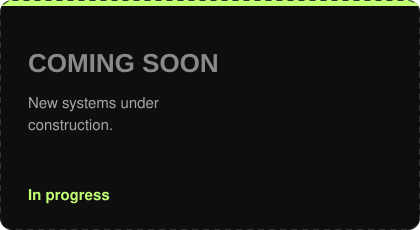

<h3>Tech stack</h3>

  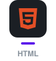
  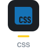
  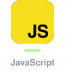
  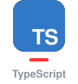
  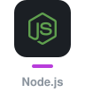
  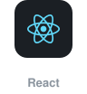
  
  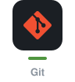
  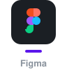

