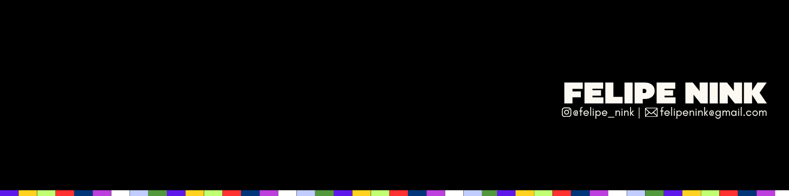
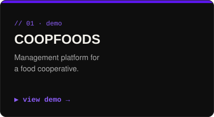
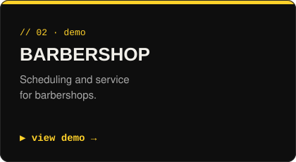
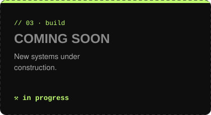

  <a href="https://github.com/FelipeNink">PT</a> · <b>EN</b>

  

  Developer · building systems that solve real business problems

  
  
  

<h3>// demos</h3>

  
  
  

<h3>// stack</h3>

  

