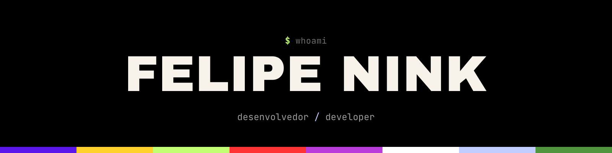
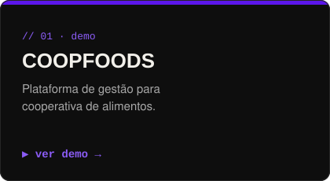
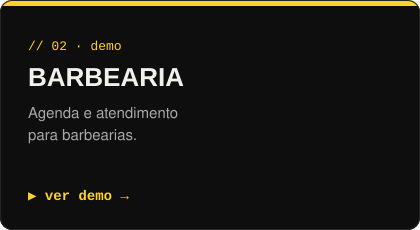
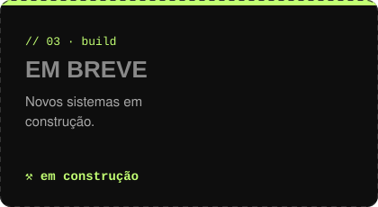

  <b>PT</b> · <a href="https://github.com/FelipeNink/FelipeNink/blob/main/README.en.md">EN</a>

  

  Desenvolvedor · sistemas que resolvem problemas de negócios reais

  
  
  

<h3>// demos</h3>

  
  
  

<h3>// stack</h3>

  

